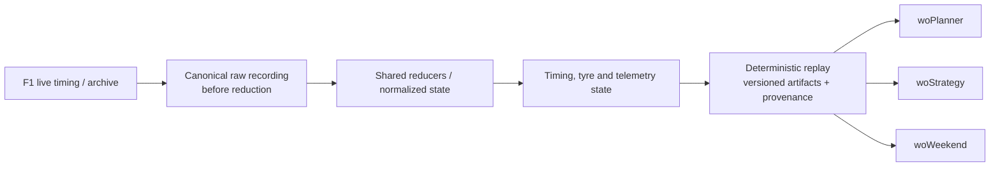

# woData

`woData` is the reproducible data layer for the dr-wo Formula 1 strategy
ecosystem. It resolves event identity, ingests live timing, records canonical raw
messages before reduction, reconstructs timing/tyre/telemetry state, builds
deterministic archive replays, and owns the versioned contracts and provenance
used by `woPlanner`, `woStrategy` and `woWeekend`.

All inputs are public F1 data. Missing timing or metadata remains unknown rather
than being replaced with a convenient estimate.

## Data flow



The same message contracts and reducers are used for live timing and archive
replay where applicable. High-volume telemetry can cross a worker boundary for
performance, but it is still recorded first. Immutable workflow artifacts carry
hashes and explicit references; a missing source remains a failure instead of
silently selecting a newer cache.

## What to inspect

- [`src/wodata/live/recorder.py`](src/wodata/live/recorder.py) and
  [`src/wodata/live/replay/`](src/wodata/live/replay/) — raw-first recording,
  archive construction, playback and fault injection.
- [`src/wodata/live/reducer.py`](src/wodata/live/reducer.py) — source-neutral
  timing, tyre and telemetry state reduction.
- [`src/wodata/contracts.py`](src/wodata/contracts.py) and
  [`src/wodata/artifacts.py`](src/wodata/artifacts.py) — shared schemas,
  deterministic hashes and versioned outputs.
- [`src/wodata/events.py`](src/wodata/events.py) and
  [`src/wodata/weekend_runs.py`](src/wodata/weekend_runs.py) — canonical event
  metadata and immutable weekend-run storage.

## Event identity and race distance

`wodata.events` resolves a canonical `YYYY-RR` event identifier into FastF1
schedule metadata. Legacy identifiers with a descriptive suffix, such as
`2026-07-Monaco`, are accepted but canonicalized to `2026-07`.

Race distance resolution is provenance-aware. A manual override wins first,
followed by versioned pre-race metadata in
`src/wodata/data/event_metadata/schema_v1/events.json`, then FastF1's loaded
Race session metadata/results. If none of those sources provides a defensible
distance, the result remains unavailable rather than being inferred from partial
live laps. Packaged event metadata should record its source URL and verification
date.

```python
from wodata import resolve_event, resolve_race_distance

event = resolve_event("2026-12")
total_laps, source = resolve_race_distance(event)
```

## Weekend workflow runs

`WeekendRunStore` provides immutable, versioned storage for small cross-package
weekend workflow outputs under:

```text
woweekend/runs/schema_v1/
  event=YYYY-RR/workflow=WORKFLOW/runs/RUN_ID/
```

Each run records its identity and generation time. Saved artifacts cannot be
overwritten and have SHA256/size metadata. A manifest status of `SUCCESS` or
`PARTIAL` makes a run eligible for `select_before(...)`, which supports strict
pre-session selection and required-artifact checks. Heavy reproducible caches
are stored as explicit artifact references; a missing referenced target fails
instead of silently substituting a newer cache.

```python
from wodata import WeekendRunStore

run = WeekendRunStore.create(event="2026-12", workflow="race_preparation")
run.save_json("config.input", {"source": "operator"})
run.save_manifest({"status": "SUCCESS"})
```

## Event operational history

`wodata.event_operational` stores one replaceable latest/final operational
record per event under
`woweekend/event_operational_inputs/schema_v1/year=YYYY/round=RR/`. These files
are durable mirrors of values adopted through woPlanner's Apply action; the
editable authority remains `woWeekend/configs/race.json`. They are not
immutable run snapshots and they are not empirical observations.

Cross-season lookup requires a stable circuit identity (`circuit_id`, or
country plus location, with a circuit label as a final explicit identifier).
Display-name-only matching is deliberately rejected, and ambiguous matches are
reported as unavailable. Consumers may present a prior event's operational
record beside separately labelled post-race empirical evidence, but neither is
a current-event calculation or autofill source.

The current schema is `schema_v1`. Each season/round record stores resolved total
laps plus separate GREEN, SC, and VSC operational totals; null means unresolved.
Legacy combined SC/VSC may be retained only with its explicit context-only role
and is never promoted into SC or VSC. Provenance identifies the accepted editable
source and writer. On partial updates, an omitted API field preserves the durable
value already recorded, while an explicit null intentionally clears a field when
that API call supports clearing it.

A durable record must have sufficient stable event/circuit identity belonging to
its requested `(season, round)`. Identity cached for another event is not trusted:
canonical event metadata is resolved when ownership is absent or mismatched, and
conflicting supplied identity is discarded in favour of the requested event.
The store is therefore durable history of accepted operational state, not a
second independently editable live configuration source.

## Live timing

The optional `wodata.live` package provides authenticated FastF1 live ingestion,
mandatory raw recording, deterministic replay, completed-lap state reduction, and
sector-level timing when the live feed includes `TimingData.Lines[*].Sectors`.

### Live reduction and worker boundary

The live controller now distinguishes planner-state topics from high-volume
telemetry topics. `CarData.z` and `Position.z` can be sent to a configured
telemetry sink instead of being copied through the GUI/controller reduction
queue. Timing, tyres, track status, session state, driver state, and `LapCount`
continue through `LiveSessionStore`. `DrainResult.changes` reports the affected
planner areas; a telemetry-only drain is deliberately not a planner redraw.

This split is a performance boundary, not a data-loss policy. Raw recording still
happens before routing. Replay sources may be back-pressured by the consumer so a
max-speed replay cannot outrun the telemetry/analysis queues. Cancellation wakes
that wait during stop/reset.

`LiveSessionStore` defaults to a rolling 12-lap `CarData.z` window and a
time-based 20-minute `Position.z` window. Tests and analysis workers may request
unbounded telemetry or a fixed position-sample limit. The raw recording remains
the authoritative full-fidelity source whenever an in-memory window has trimmed
old samples.

Compressed telemetry timestamps are converted into the session-time clock when
both the packet session time and source timestamp exist. Falling back to Unix
epoch seconds is retained only for inputs without that anchoring information.
Future traffic/debug code must not compare those two clock domains as if they
were interchangeable.

`LapCount.TotalLaps` is captured once as `LiveSessionSnapshot.scheduled_total_laps`.
It is the originally scheduled Race/Sprint distance and must not be inferred from
the greatest completed lap. Consumers should prefer it over manual configuration
or current-leader fallbacks.

```bash
pip install -e ../Fast-F1
pip install -e ".[live]"
```

Recordings use the shared data root under
`wodata/live_timing/schema_v1/year=.../round=.../session=...`.

`LiveTimingController.start_live()` records every canonical raw message to
`live_timing_raw.jsonl` before reduction. The v2 envelope preserves message
schema, source/receive timestamps, source identity, sequence, and the original
session-time value. Legacy `live_timing_raw*.txt` recordings remain readable.
Either format can be passed to `ReplayLiveTimingSource` for deterministic debugging.
If a recording starts late
or the feed omits a lap/sector time, the reducer keeps the data it has and marks
later cumulative timing unknown after internal gaps instead of fabricating a
continuous race clock.

`LiveSessionStore` owns the canonical racing-time axis consumed by downstream
applications. Wall-clock time while a Race is suspended is excluded, and all
drivers use a common race-time origin when source timing provides a reliable
anchor. A late original `Started` event may recover that origin from source
chronology, but restart `Started` events never reset it. When no reliable common
anchor exists, cumulative timing remains explicitly unavailable instead of
zero-basing each driver independently. Laps or sectors that cross a suspension
likewise remain unavailable until they can be anchored safely.

### Canonical history and provisional observations

Sparse raw `TimingData` may contain ambiguous lap identity, delayed values, or
corrections. `LiveSessionSnapshot.completed_laps` and `completed_sectors` are
conservative committed history. `provisional_sectors` retains revisable pending
observations separately, and `live_timing` retains official lap/order/gap fields
with their publication provenance. Analysis consumers should trust committed
history, not promote pending observations themselves.

Sector promotion requires a complete duration-consistent tuple and independent
source/boundary certification: each sector publication must fall after the
preceding observed counter boundary (or preceding committed-lap boundary) and
at or before the retained completion-counter boundary. Lap 1 requires an
observed initial `Started` boundary; an inferred race origin is insufficient.
An inferred pending generation and a matching sector sum alone never certify
sector identity. Missing provenance or an unavailable preceding restart lap
prevents promotion. Publication timestamps are evidence bounds, not assumed
physical line-crossing times.

Equal consecutive `LastLapTime` values remain valid, and completed-lap timing
can be retained when sector detail cannot be certified. Unsupported canonical
sectors are intentionally omitted: this conservative omission protects history
and analytical inputs rather than filling gaps with ambiguous evidence. Missing
cumulative bases remain unavailable and never become zero. Presentation policy
for provisional observations belongs to downstream applications.

For Race sessions, reconnecting discovers non-empty recordings in the event
directory, rejects files whose `SessionInfo` identifies another event, merges
accepted captures deterministically, restores reducer/telemetry state, and then
starts a new unused recording. Envelope recordings are merged by receive time
without violating order within any source; only certainly adjacent duplicate
observations are removed, so later corrections survive. Recovery temporarily
permits an explicit `Retired: false` update to reactivate a driver while normal
live reduction keeps retirement final.

`recover_replay_directory(...)` exposes the same merge as a reusable
`recovered_replay.jsonl` plus manifest. Source size and SHA256 identities make
the output cacheable: unchanged sources reuse it, while any changed capture
rebuilds it. Stop/reset cancels replay flow-control waits promptly.

Incremental `TimingData` sector patches can produce provisional observations as
soon as S1, S2, or S3 is available; a full lap is not required. Pending values
can revise or disappear without entering committed sector history. A driver is
cut off only when `TimingData.Lines[*].Retired` is explicitly true. The first
such message freezes the greatest completed/declared lap; missing timing, status
text, or lack of movement is deliberately not interpreted as DNF. Consequently,
a feed that omits `Retired` will not be truncated automatically. Preserve the
canonical recording when diagnosing lap attribution or retirement because late
connections may not contain earlier sectors.

Completed laps retain the track-status values observed during the lap,
pit-in/pit-out markers derived from timing and stint changes, and an explicit
validity flag. Track-status patches are accumulated across the pending lap rather
than sampling only the finish-line state.

### Archived session replay

Archive replay is a separate message source and deliberately uses the same
`LiveTimingMessage` contract, controller queue, and `LiveSessionStore` reducers as
SignalR. It does not load final FastF1 lap tables and has no replay-only analysis
path. Existing raw `.txt` replay files remain supported.

```bash
# Download selected per-topic streams and write a manifest.
python -m wodata.live.replay.cli download \
  --year 2025 --event Hungary --session R \
  --output-root ~/.wodata/live_archive

# Build a versioned, deterministic JSONL replay atomically.
python -m wodata.live.replay.cli build \
  --archive ~/.wodata/live_archive/schema_v1/year=2025/round=14/session=R

# Replay through the shared reducer at 20x.
python -m wodata.live.replay.cli play \
  ~/.wodata/live_archive/schema_v1/year=2025/round=14/session=R/replay/merged_replay_v1.jsonl \
  --speed 20

# Deterministic robustness run with missing and delayed data.
python -m wodata.live.replay.cli play merged_replay_v1.jsonl --speed 0 \
  --exclude-topic TimingAppData --delay-topic TrackStatus:15 \
  --drop-rate 0.02 --random-seed 42
```

For equal timestamps the builder orders `SessionInfo`, `DriverList`,
`SessionStatus`, `ExtrapolatedClock`, `TrackStatus`, `LapCount`, `TimingAppData`,
`TimingData`, race control, weather, then heartbeat, preserving original order
within each topic.
This is stable and reproducible, but it approximates cross-topic ordering because
the archive cannot recover the original SignalR network arrival order.

Programmatic playback supports `speed=0`, start/end session-time bounds,
pause/resume/stop, topic exclusion, drop-after, delay, and seeded random
drop/duplication. Faults are applied in memory; the source replay is never changed.

For a dictionary-configured workflow like the `woStrategy` scripts, edit
`SCRIPT_CONFIG` in `src/wodata/script/fetch_replay_data.py` and run:

```bash
PYTHONPATH=src ../.venv/bin/python -m wodata.script.fetch_replay_data
```

Set `workflow` to `"fetch_replay_data"` and use the `download`, `build`, and `play`
switches in any combination. Normally only `year`, `round_number`, and `session`
identify the session; `event` can remain `None` and is only a fallback when the
round is unknown. Set `workflow` to `"live_record"` to record SignalR timing
until the session ends or Ctrl-C is pressed. With `data_root=None`, all outputs are
placed under `WODATA_ROOT`, the legacy shared-root environment setting, or the
`woData` project root. Archives go below
`wodata/live_archive/` and live recordings below `wodata/live_timing/`.

The fetch workflow includes FastF1's `CarData.z` and `Position.z` archive streams
and can add them to an existing archive without downloading topics already present.
Their decoded archive records are stored below the selected session archive as
`raw/CarData.z.json` and `raw/Position.z.json`; the deterministic merged JSONL
replay contains the same canonical messages. During reduction, `CarData.z` becomes
timestamped speed samples with inferred lap attribution and is retained in a
rolling 12-lap buffer per driver. `Position.z` becomes a separate XYZ diagnostic
buffer. The shared traffic calculation consumes the speed buffer and does not wait
for, merge, or repeatedly rebuild laps from the larger position stream.

This separation is deliberate. `CarData.z` has the speed channel needed by the
shared progress integrator, whereas raw XYZ positions require track projection and
orientation calibration before they represent along-track distance. Keeping
Position.z diagnostic avoids making replay speed and traffic availability depend
on that unresolved calibration. Because `CarData.z` has no strategy lap number,
the reducer assigns samples using the latest completed timing state and assumes
messages are processed chronologically; delayed timing near a finish line can move
a small number of samples to an adjacent lap. The bounded 12-lap buffer controls
live memory and recalculation cost, at the cost of not retaining full-race
telemetry in a live snapshot. Raw recordings and archive files remain complete.
The old `archive_replay` workflow and module names remain compatibility aliases.
Use `fetch_replay_data` for completed sessions. `live_record` only receives data while
Formula 1 is actively broadcasting the configured session and requires F1TV
authentication. The recorder opens its destination lazily on the first message and
selects an unused filename rather than replacing a non-empty capture.

## Strategy Prediction analysis contracts

`wodata.contracts` defines the schema-v1 weekend-model, strategy-search, completed-lap,
and tyre-state contracts shared by woStrategy and woPlanner. `wodata.artifacts` writes
canonical model and strategy CSV/JSON artifacts below `WODATA_ROOT/wostrategy/`, with
manifests, deterministic hashes, provenance, and append-only run history.

`ModelSnapshot.sampler_quality` is serialized into the model manifest. It is
diagnostic metadata rather than a posterior parameter. In particular, high ESS
only indicates stable importance weights; it does not imply narrow uncertainty or
strong Race evidence.

FastF1 data used by Strategy Prediction is also rooted in woData: raw FastF1 HTTP/parser cache
under `fastf1/raw_cache/schema_v1`, derived telemetry under `fastf1/telemetry/schema_v1`,
and enriched session laps under `fastf1/session_laps/schema_v1`.

## woStrategy cache layout

woData is a runtime dependency of woStrategy and owns its shared cache paths.
The default layout is:

```text
woData/
  fastf1/
    raw_cache/schema_v1/
    telemetry/schema_v1/
    session_laps/schema_v1/year=YYYY/round=N/session=FP1/laps.pkl
  wostrategy/
    race_performance_review/schema_v1/
      year=YYYY/round=N/session=R/
        tyre_information.csv
        race_performance_YYYY_N_R_*.csv
      year=YYYY/range=1-11/session=R/
        tyre_information.csv
        race_performance_*.csv
```

`tyre_information.csv` is the compact, canonical consumer view of tyre baseline
speed, compound delta, and degradation. It includes global and team scopes.
Detailed Monte Carlo samples, clean laps, diagnostics, and metadata deliberately
remain as separate files in the same partition because they can be much larger.

`WODATA_ROOT` may point to a different shared data root. `WOSTRATEGY_DATA_ROOT`
is still accepted as a legacy environment override. With sibling checkouts and
no override, running from woStrategy or woPlanner resolves the adjacent `woData`
directory automatically.

## Pirelli previews

The downstream interpretation of these descriptors, including the ordinal 1-5 endpoint
compromise and the cross-event model's complete assumptions, is documented in
[`woStrategy/doc/CROSS_EVENT_TYRE_PREDICTION_V1.md`](https://github.com/dr-wo/woStrategy/blob/main/doc/CROSS_EVENT_TYRE_PREDICTION_V1.md).

Pirelli preview images and validated extraction artifacts use:

```text
pirelli_preview/year=YYYY/
  1920_NN-*-preview-en.jpg
  extracted/round=N.json
  pirelli_preview_YYYY.csv
```

The image SHA256 controls extraction caching. Vision output is validated and stored
as per-event JSON; the annual CSV is rebuilt deterministically and is never edited
by the vision model. Missing or ambiguous values remain null and require manual
review. `traction` and `lateral` are retained as raw descriptors but are not V1
tyre-prediction features.

## Team and driver colours

`wodata.colours` is the shared source of truth for team and driver plotting
colours across the dr-wo packages. The current values come from the 2026
FastF1 live-timing `DriverList` `TeamColour` field. FastF1 assigns each driver
their team's colour, so the driver map is derived from the same team palette.

```python
from wodata.colours import get_driver_colour, get_team_colour

assert get_team_colour("McLaren") == "#F47600"
assert get_driver_colour("NOR") == "#F47600"
```

Both British (`TEAM_COLOURS`, `DRIVER_COLOURS`) and American
(`TEAM_COLORS`, `DRIVER_COLORS`) spellings are exported. `F1_TEAM_COLORS`
also includes legacy aliases used by historic data and existing plots.

When a new season changes teams, drivers, or colours, update
`src/wodata/colours.py` from a complete FastF1 `DriverList` and update
`tests/test_colours.py`. Consumer packages should import the shared mappings
instead of defining local palettes.

## Development context

Cross-repository pace/tyre artifacts follow
[`CANONICAL_PACE_CONTRACT.md`](CANONICAL_PACE_CONTRACT.md). Producers should
write its artifact-level semantics and consumers should preserve them without
inventing missing legacy provenance.

This project is developed extensively with coding agents. Durable context in the
code, tests and adjacent package documentation preserves interfaces, assumptions,
known compromises and validation requirements across development sessions.

### Historical race interruption contract

woData owns source access, venue identity and the persisted bounded contract in
`src/wodata/interruption_history.py`. The canonical result is stored at
`<data_root>/wostrategy/interruption_history/schema_v1/year=YYYY/round=RR/history.json`.
`write_history` validates and atomically replaces it; `load_history` validates it and
reads local files only. Acquisition reuses FastF1's canonical raw cache and original
`track_status`, `session_status`, `session_start_time`, raw `laps.Time`, and race-control
aborted-start evidence. woStrategy owns extraction/preparation; woWeekend and
woPlanner consume the same saved values.

The history selects the latest five **prior races at the same venue**, including
skipped years and multiple races in a season. It excludes the target, later rounds,
and races not proved earlier than both the target race and acquisition cutoff.
Missing/`NaT` race dates fall back through `Session5DateUtc`, `Session5Date` and
`EventDate`; a same-season edition without chronological evidence is excluded and
selection is marked incomplete. A date-only value on the cutoff day is ambiguous.
Matching reuses woData's operational identity policy: circuit ID, then
country/location, then circuit text; event display names are not keys. Available
identity and schedule provenance are retained. Layout changes are not inferred,
normalized or excluded; venue identity does not assert equivalent layouts.

Only race-time Safety Car (`TrackStatus=4`) and Red Flag (`5`) occurrences are
inventoried; pure VSC (`6`/`7`) is excluded. Stable timestamp/source order preserves
multiple events within a lap, while contiguous repeated messages add no occurrence.
An unknown interval can split one minimum occurrence into uncertain fragments:
`SC → unknown → SC` proves **at least one**, not two. Only a trusted differing status
proves an intervening exit and supports another distinct minimum occurrence.
Fragments retain unknown boundaries and may represent separate deployments.

FastF1's first SessionStatus `Started` is an initial candidate. A non-generated raw
race-lap completion after that candidate and before suspension/start-abort
corroborates genuine racing and locks the original start. Before corroboration,
a mapped explicit `START ABORTED`/`ABORTED START` can move the candidate to a later
`Started`; after corroboration, later aborted restarts never replace it. Missing or
conflicting original-start/abort evidence leaves admission ambiguous. Raw completed
race laps at or before any candidate `Started` prevent treating a restart as the
original start, even if a backmarker completes the same lap later. Prior suspension
or abort evidence does not override those earlier completions. This also
conservatively leaves a race suspended before its first reliable completed lap
ambiguous. Formation interruptions ending before the admitted start are excluded;
a pre-start SC/RF still active at the start has no proven post-start deployment and
is excluded with a coverage warning.

Approximate leader boundaries require independent original timing-stream evidence:
reported `Position=1` on consecutive leader lap labels `LAP N → LAP N+1` identifies
the driver completing lap N. woData acquires that stream through FastF1's existing
cached timing API; woStrategy uses only that driver's non-generated raw `laps.Time`
for the boundary. FastF1's `laps.Position` ranks remaining completion rows and is
not authority evidence. A missing leader row/time, missing independent lap advance,
or unknown generation flag leaves the boundary unavailable; neither a later
backmarker nor a later leader report repairs it. Raw session elapsed time includes
suspension gaps. Non-monotonic/inconsistent chains still fail closed, and a missing
boundary needed for an interval yields `lap=null` while retaining the occurrence.

**The displayed SC range is the set of laps during which SC status was active for
any portion of the lap.** Entry uses `[lap start, lap end)` and withdrawal uses
`(lap start, lap end]`: partial L11 through partial L13 displays `~L11–13`, while
withdrawal exactly at the L1 completion displays `~L1`, excluding L2. A direct
SC → Red Flag transition ends the SC there and is labelled accordingly. Red Flag
uses only its entry lap, never a suspension-duration range. Zero-duration updates
at a boundary retain the occurrence with unavailable lap context.

`schema_version=1`, `semantic_role=historical_race_interruptions` preserves the
target, newest-first identities, selection provenance, source integrity evidence,
start-admission evidence, coverage reasons, timeline hash, and SC/Red Flag families.
Each family has `occurred` (true/false/null), `count` (exact integer/null),
`observed_count` (minimum distinct occurrences), and chronological `occurrences`
with cross-family sequence, original seconds/source indexes, uncertain fragments,
trusted exit proof and approximate/unavailable laps. Missing deployment boundaries
retain `start_seconds=null`, unavailable start laps and `first_observed_seconds`.
Validation rejects unsupported enums, inconsistent null/timestamp/lap values,
backwards/overlapping known intervals, unsupported grouping, contradictory counts,
missing provenance, and complete records lacking required deployment boundaries.
Legitimate partial/ambiguous records remain representable. Unsupported older draft
artifacts degrade to unavailable and must be explicitly prepared again.

**Confirmed zero requires affirmative TrackStatus integrity**, supported original
race admission, start baseline, terminal lifecycle, valid transitions and
unambiguous required deployment boundaries. The source must explicitly provide
`track_status_integrity.status=verified_complete` with nonempty evidence identifying
a completeness/integrity check. A boolean, lifecycle completion, timeline hash,
HTTP success or parser-version match is insufficient. The inspected FastF1 3.8.3
TrackStatus parser/cache provides no such signal: its adapter emits integrity
`unknown` with no affirmative evidence. Therefore its historical empty streams
show **No event observed; coverage unproven**, never confirmed “No SC”/“No Red Flag”.
Observed positive events remain confirmed minimums with null exact totals, shown as
**at least N (incomplete)**. Only explicit integrity-checked fixture sources currently
exercise confirmed-zero behavior. Report and Planner use the same local artifact
and formatting; neither acquires data on render/reload. This descriptive context
never changes strategy, probabilities or operational inputs.
